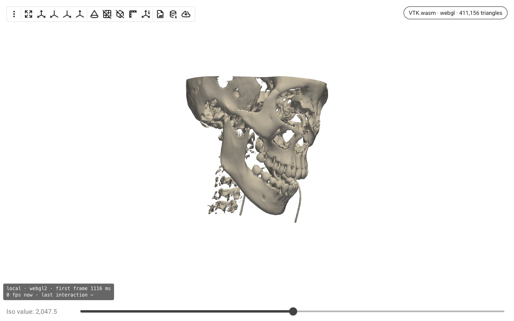
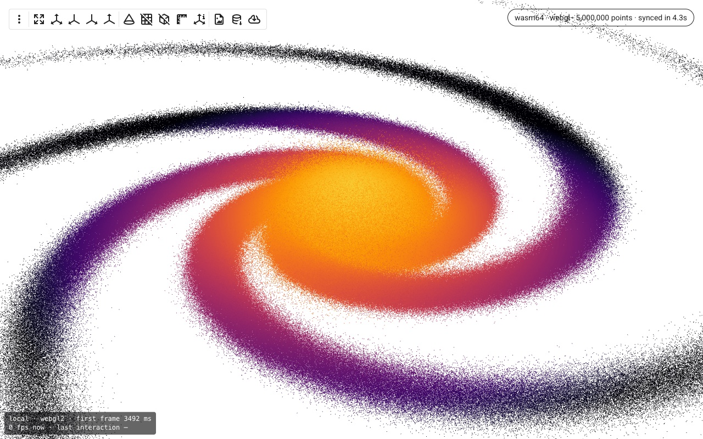
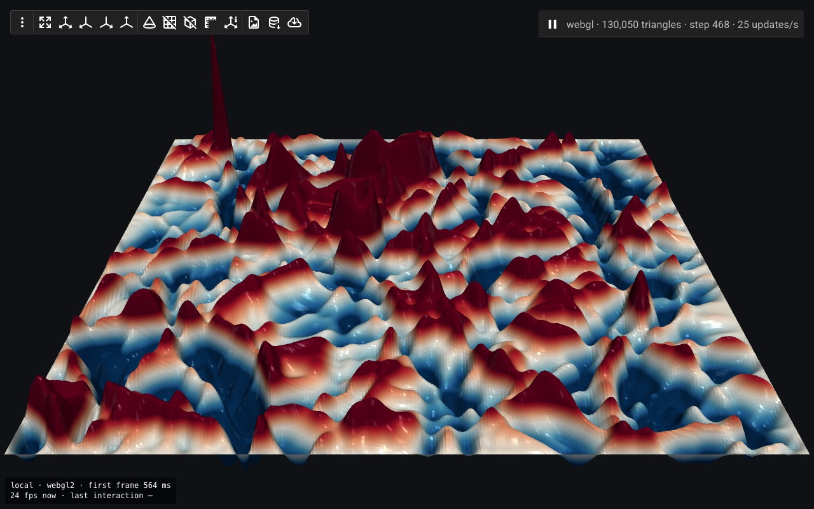
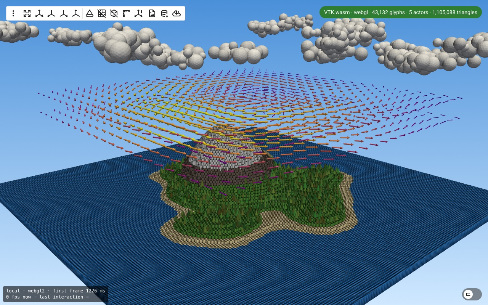
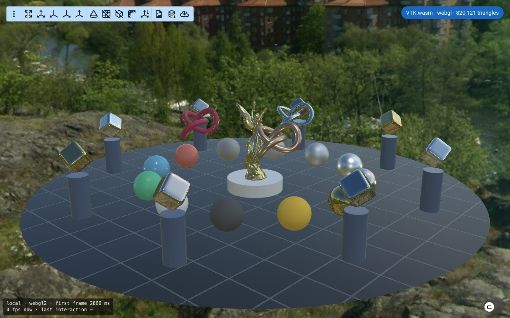
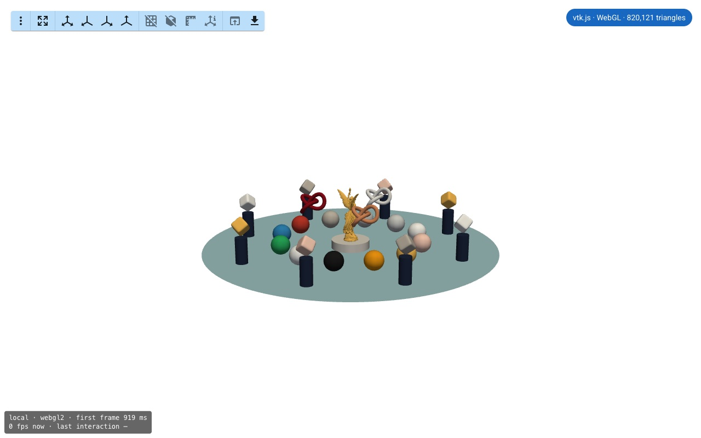
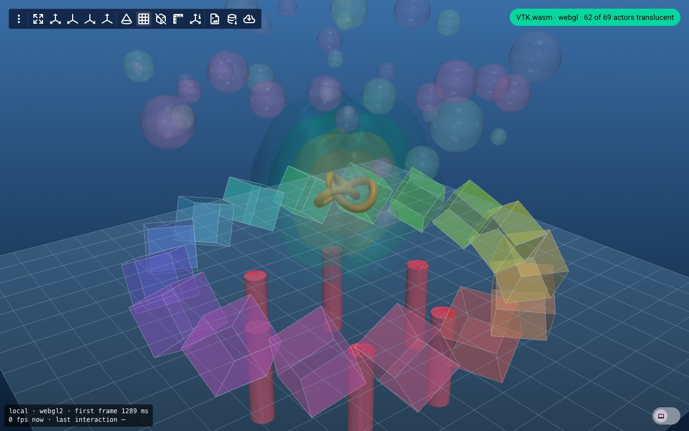
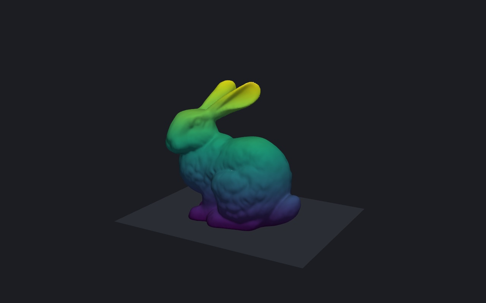

# vtk-demo

Fancy VTK / PyVista scenes that show off VTK capabilities and performance:
GPU instancing, composite datasets, PBR, transparency, huge point clouds, live
simulations… plus the demo applications built on them (VTK.wasm + WebGPU in
the browser with trame, standalone HTML exports, and Dear ImGui).

## Install

```bash
pip install vtk-demo              # scenes only (vtk, pyvista)
pip install "vtk-demo[trame]"     # + web applications
pip install "vtk-demo[export]"    # + standalone HTML export
pip install "vtk-demo[all]"
```

## Reusable scenes

`vtk_demo.scenes` is plain VTK and numpy, through VTK's Python friendly API
(keyword constructors, snake_case properties, numpy backed arrays, `>>`
pipelines). Every `build_*` function fills a `vtkRenderer` (actors,
background, camera) and returns a few statistics:

```python
import vtkmodules.vtkInteractionStyle  # noqa: F401
import vtkmodules.vtkRenderingOpenGL2  # noqa: F401
from vtkmodules.vtkRenderingCore import (
    vtkRenderer,
    vtkRenderWindow,
    vtkRenderWindowInteractor,
)

from vtk_demo.scenes import build_glyph_island

renderer = vtkRenderer()
n_actors, n_instances, n_triangles = build_glyph_island(renderer)
window = vtkRenderWindow(size=(1280, 800))
window.AddRenderer(renderer)
interactor = vtkRenderWindowInteractor(render_window=window)
interactor.Start()
```

PyVista only comes in with the applications, through a small adapter that
builds a scene into a plotter and keeps the scene's camera:

```python
import pyvista as pv
from vtk_demo.pyvista_adapter import add_scene
from vtk_demo.scenes import build_glyph_island

plotter = pv.Plotter()
n_actors, n_instances, n_triangles = add_scene(plotter, build_glyph_island)
plotter.show()
```

| Module | What it provides |
| --- | --- |
| `scenes.instancing` | `InstanceLayer`: many copies of one mesh, drawn with a `vtkGlyph3DMapper` (`glyph_actor`), one actor per copy (`instance_actors`) or baked into one mesh (`bake_layer`) |
| `scenes.composite` | `composite_actor`, `scattered_collection`, `partitioned_collection`: many meshes in one `vtkCompositePolyDataMapper` actor |
| `scenes.island` | The 43k object voxel island, drawn four ways: `build_glyph_island`, `build_actor_island`, `build_archipelago`, `build_partitioned_island` |
| `scenes.pbr` | `build_pbr_scene`: PBR materials and image based lighting |
| `scenes.transparency` | `build_transparency_scene`: depth peeling stress test |
| `scenes.galaxy` | `build_galaxy_scene`: tens of millions of points |
| `scenes.wave` | `WaveSurface`, `build_wave_scene`: a mesh updated live by a simulation |
| `scenes.isosurface` | `Isosurface`, `build_isosurface_scene`: live `vtkFlyingEdges3D` contour |
| `scenes.bunny` | `build_bunny_scene` |
| `scenes.benchmark` | `build_sphere_mesh`, `build_sphere_actors`: synthetic throughput scenes |
| `scenes.primitives` | Shapes (`cube`, `cylinder`, `cone`, `arrow`, `icosphere`, `super_ellipsoid`, `trefoil`) and textures (`stone_tiles_texture`, `image_texture`) |
| `scenes.core` | VTK and numpy helpers: `mesh_actor`, `make_property`, `rgb`, `lookup_table`, `vtk_points`, `transformed`, `set_camera`… |
| `scenes.datasets` | `bunny`, `lucy`, `head`, `sky_box`: example data, downloaded once to `~/.cache/vtk-demo` (or `$VTK_DEMO_DATA`) |

## Demo applications

```bash
vtk-demo list
vtk-demo run trame.glyph            # VTK.wasm on WebGL 2
vtk-demo run trame.glyph --webgpu   # WebGPU in the browser and on the server
vtk-demo run trame.galaxy --help
```

Without installing anything, [uv](https://docs.astral.sh/uv/) can run any demo
against a VTK of your choice, here a nightly from
[wheels.vtk.org](https://wheels.vtk.org) (`-p 0` picks a free port):

```bash
uvx --with "vtk>9.7.1" --pre --index-url https://wheels.vtk.org "vtk-demo[trame]" run trame.animation -p 0
```

Demos are grouped by UI toolkit, under `vtk_demo.apps`:

- **trame**: `contour`, `galaxy`, `animation`, `pbr`,
  `pbr-legacy`, `transparency`, `glyph`
- **export**: `bunny-html`, a self-contained VTK.wasm HTML page
- **imgui**: `contour`, the trame contour demo as a native desktop window

Every demo is also a runnable module, e.g. `python -m vtk_demo.apps.trame.glyph`.

The SimpleViewer based trame demos report first frame and interaction times:
see `vtk_demo/apps/trame/observability.py` (`--obs-log`, `--obs-verbose`, `--no-hud`).

### Gallery

Each demo with its default options, VTK.wasm (or vtk.js) on WebGL 2 in Chrome:

| | |
| --- | --- |
| `trame.contour`: isosurface of a CT scan, filtered on the server | `trame.galaxy`: millions of points with VTK.wasm 64-bit |
|  |  |
| `trame.animation`: wave equation stepped in numpy, streamed live | `trame.glyph`: 43k object voxel island, GPU instancing |
|  |  |
| `trame.pbr`: PBR materials and image based lighting | `trame.pbr-legacy`: the same scene with vtk.js |
|  |  |
| `trame.transparency`: depth peeling stress test | `export.bunny-html`: self-contained HTML page, no server |
|  |  |

### Notes

- `--webgpu` also asks the server to render with WebGPU, which needs a VTK
  built with `VTK_ENABLE_WEBGPU=ON`; otherwise the server falls back to OpenGL,
  as shown in the chip when rendering remotely.
- VTK's WebGPU backend has no PBR shaders yet: `pbr --webgpu` is Phong shaded.
- The uv setup (`uv sync`, nox, CI) pins a VTK nightly from
  [wheels.vtk.org](https://wheels.vtk.org) (`[tool.uv]` in `pyproject.toml`):
  with VTK 9.7.1, VTK.wasm keeps drawing the first frame of `trame.animation`.
  `pip install vtk-demo` uses the latest VTK release instead; to get a nightly
  with pip: `pip install --pre --extra-index-url https://wheels.vtk.org "vtk>9.7.1"`.

## Contributing

See [CONTRIBUTING.md](CONTRIBUTING.md) for the development setup, how to add a
demo and how releases are made.

## License

[Apache License 2.0](LICENSE)
