# vtk-demo

Fancy VTK / PyVista scenes that show off VTK capabilities and performance:
GPU instancing, composite datasets, PBR, transparency, huge point clouds, live
simulations… plus the demo applications built on them (VTK.wasm + WebGPU in
the browser with trame, standalone HTML exports, and Dear ImGui).

## Install

```bash
pip install vtk-demo              # scenes, web applications (trame) and HTML export
pip install "vtk-demo[imgui]"     # + native desktop applications (Dear ImGui)
pip install "vtk-demo[all]"
```

This installs the latest VTK release from PyPI, or keeps the VTK already
installed (9.7 or newer). A few demos need fixes that are only in VTK nightlies
for now, and warn on startup when VTK is too old:

| Demo | Needs | Without it |
| --- | --- | --- |
| `trame.animation` | newer than 9.7.1 | VTK.wasm keeps drawing the first frame |
| `trame.asteroid-impact`, `trame.bearing-assembly` | nightly of 2026-10-11 or later | the WebGPU view has no sorted (deep framebuffer) transparency |

pip and uv cannot get nightlies from the package metadata: ask for one from
[wheels.vtk.org](https://wheels.vtk.org) when installing. The demos are tested
with `9.7.20261101.dev0`:

```bash
# the tested nightly
pip install --extra-index-url https://wheels.vtk.org vtk-demo "vtk==9.7.20261101.dev0"

# or the newest nightly (pip picks the highest version across both indexes)
pip install --pre --extra-index-url https://wheels.vtk.org vtk-demo
```

## Reusable scenes

`vtk_demo.scenes` is plain VTK and numpy, through VTK's Python friendly API
(keyword constructors, snake_case properties, numpy backed arrays, `>>`
pipelines). Every `build_*` function fills a `vtkRenderer` (actors,
background, camera) and returns a few statistics:

```python
import vtkmodules.vtkInteractionStyle  # noqa: F401
import vtkmodules.vtkRenderingOpenGL2  # noqa: F401
from vtkmodules.vtkRenderingCore import (
    vtkRenderer,
    vtkRenderWindow,
    vtkRenderWindowInteractor,
)

from vtk_demo.scenes import build_glyph_island

renderer = vtkRenderer()
n_actors, n_instances, n_triangles = build_glyph_island(renderer)
window = vtkRenderWindow(size=(1280, 800))
window.AddRenderer(renderer)
interactor = vtkRenderWindowInteractor(render_window=window)
interactor.Start()
```

PyVista only comes in with the applications, through a small adapter that
builds a scene into a plotter and keeps the scene's camera:

```python
import pyvista as pv
from vtk_demo.pyvista_adapter import add_scene
from vtk_demo.scenes import build_glyph_island

plotter = pv.Plotter()
n_actors, n_instances, n_triangles = add_scene(plotter, build_glyph_island)
plotter.show()
```

| Module | What it provides |
| --- | --- |
| `scenes.instancing` | `InstanceLayer`: many copies of one mesh, drawn with a `vtkGlyph3DMapper` (`glyph_actor`), one actor per copy (`instance_actors`) or baked into one mesh (`bake_layer`) |
| `scenes.composite` | `composite_actor`, `scattered_collection`, `partitioned_collection`: many meshes in one `vtkCompositePolyDataMapper` actor |
| `scenes.island` | The 43k object voxel island, drawn four ways: `build_glyph_island`, `build_actor_island`, `build_archipelago`, `build_partitioned_island` |
| `scenes.pbr` | `build_pbr_scene`: PBR materials and image based lighting |
| `scenes.transparency` | `build_transparency_scene`: depth peeling stress test |
| `scenes.galaxy` | `build_galaxy_scene`: tens of millions of points |
| `scenes.wave` | `WaveSurface`, `build_wave_scene`: a mesh updated live by a simulation |
| `scenes.isosurface` | `Isosurface`, `build_isosurface_scene`: live `vtkFlyingEdges3D` contour |
| `scenes.volume_rendering` | `VolumeRendering`, `build_volume_rendering_scene`: GPU ray cast volume with 3D Slicer's CT presets (`PRESETS`), shift and shading changed live |
| `scenes.bunny` | `build_bunny_scene` |
| `scenes.benchmark` | `build_sphere_mesh`, `build_sphere_actors`: synthetic throughput scenes |
| `scenes.primitives` | Shapes (`cube`, `cylinder`, `cone`, `arrow`, `icosphere`, `super_ellipsoid`, `trefoil`) and textures (`stone_tiles_texture`, `image_texture`) |
| `scenes.core` | VTK and numpy helpers: `mesh_actor`, `make_property`, `rgb`, `lookup_table`, `vtk_points`, `transformed`, `set_camera`… |
| `scenes.datasets` | `bunny`, `lucy`, `head`, `sky_box`: example data, downloaded once to `~/.cache/vtk-demo` (or `$VTK_DEMO_DATA`) |

## Demo applications

```bash
vtk-demo list
vtk-demo run trame.glyph            # VTK.wasm on WebGL 2
vtk-demo run trame.glyph --webgpu   # WebGPU in the browser and on the server
vtk-demo run trame.galaxy --help
```

Without installing anything, [uv](https://docs.astral.sh/uv/) runs any demo
with `uvx`: every demo below comes with its command. Add `-p 0` to have trame
pick a free port, or any of the demo options (`--webgpu`, `--help`…). The
demos that need a VTK nightly get one from [wheels.vtk.org](https://wheels.vtk.org).

Demos are grouped by UI toolkit, under `vtk_demo.apps`:

| Demo | What it shows | Run it with uv |
| --- | --- | --- |
| `trame.contour` | Isosurface of a CT scan, filtered on the server | `uvx vtk-demo run trame.contour` |
| `trame.volume-rendering` | Chest CT (or any 3D Slicer CT / MRI sample) ray cast with 3D Slicer presets | `uvx vtk-demo run trame.volume-rendering` |
| `trame.live-processing` | FEA bracket thresholded by stress, filtered on the server | `uvx vtk-demo run trame.live-processing` |
| `trame.galaxy` | Tens of millions of points with VTK.wasm 64-bit | `uvx vtk-demo run trame.galaxy` |
| `trame.animation` | Wave equation stepped in numpy, streamed live | `uvx --with "vtk==9.7.20261101.dev0" --index-url https://wheels.vtk.org vtk-demo run trame.animation` |
| `trame.pbr` | PBR materials and image based lighting | `uvx vtk-demo run trame.pbr` |
| `trame.pbr-legacy` | The same PBR scene with vtk.js | `uvx vtk-demo run trame.pbr-legacy` |
| `trame.transparency` | Depth peeling stress test | `uvx vtk-demo run trame.transparency` |
| `trame.asteroid-impact` | WebGL weighted blend vs. WebGPU deep framebuffer | `uvx --with "vtk==9.7.20261101.dev0" --index-url https://wheels.vtk.org vtk-demo run trame.asteroid-impact` |
| `trame.bearing-assembly` | The same comparison, as a WebGL / WebGPU toggle | `uvx --with "vtk==9.7.20261101.dev0" --index-url https://wheels.vtk.org vtk-demo run trame.bearing-assembly` |
| `trame.glyph` | 43k object voxel island, GPU instancing | `uvx vtk-demo run trame.glyph` |
| `export.bunny-html` | Self-contained VTK.wasm HTML page, written to `exports/` | `uvx vtk-demo run export.bunny-html` |
| `imgui.contour` | The contour demo in a native desktop window (Python 3.11+) | `uvx --from "vtk-demo[imgui]" vtk-demo run imgui.contour` |

Every demo is also a runnable module, e.g. `python -m vtk_demo.apps.trame.glyph`.

The SimpleViewer based trame demos report first frame and interaction times:
see `vtk_demo/apps/trame/observability.py` (`--obs-log`, `--obs-verbose`, `--no-hud`).

### Volume rendering

`trame.volume-rendering` ray casts a chest CT in the browser with VTK.wasm,
using 3D Slicer's volume rendering presets, as discussed in
[How show the bone of a serial dicom files](https://discourse.vtk.org/t/how-show-the-bone-of-a-serial-dicom-files/4802).
The data is 3D Slicer's CTChest sample (`ct-chest-scene` in
`vtk_demo.data.medical`, 41 MB, downloaded on first run), read straight from
its scene bundle (`.mrb`) by `vtk_demo.io.nrrd`.

Any other 3D Slicer sample holding a 3D scalar volume, as a NRRD file or a
scene bundle, can be rendered instead with `--dataset` and its name.
`--dataset list` prints them, one per line with download size, modality and
description. MRI scans start with the MR-Default preset.

```bash
vtk-demo run trame.volume-rendering            # VTK.wasm on WebGL 2
vtk-demo run trame.volume-rendering --webgpu   # WebGPU in the browser
vtk-demo run trame.volume-rendering --dataset list
vtk-demo run trame.volume-rendering --dataset cervical-spine-ct
vtk-demo run trame.volume-rendering --dataset mr-head-scene

uvx vtk-demo run trame.volume-rendering        # without installing anything
```

The footer picks a preset (CT-Chest-Contrast-Enhanced, CT-Bone, CT-Muscle,
MR-Default…), toggles shading and shifts the transfer functions (in Hounsfield
units for CT) to fine-tune what shows up. The volume is sent to the browser once: these
controls only send the new volume property.

### Gallery

Each demo with its default options, VTK.wasm (or vtk.js) on WebGL 2 in Chrome,
or WebGPU for `trame.asteroid-impact` and `trame.bearing-assembly`:

| | |
| --- | --- |
| `trame.contour`: isosurface of a CT scan, filtered on the server | `trame.live-processing`: FEA bracket thresholded by stress, filtered on the server |
| 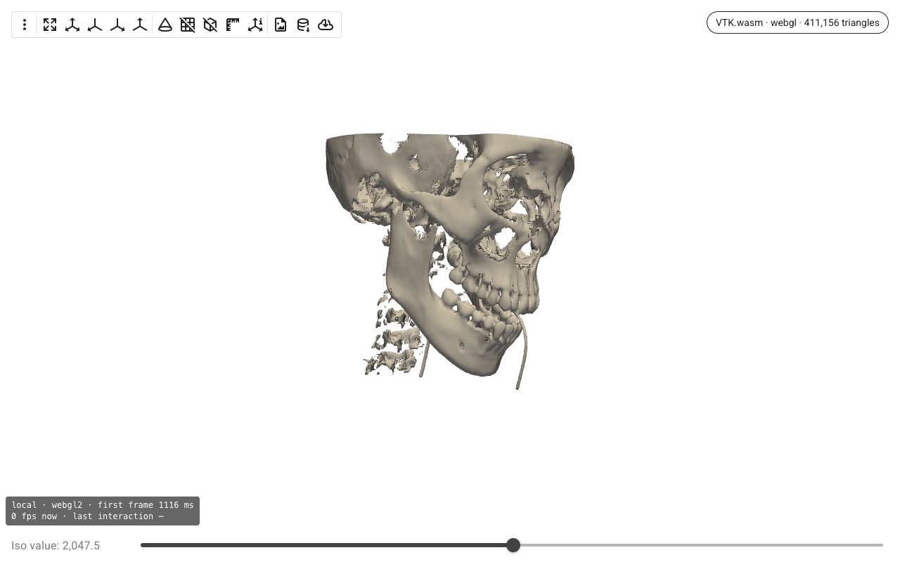 | 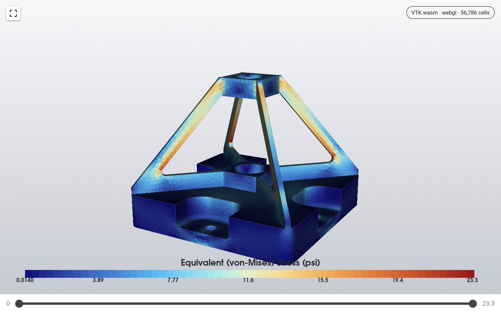 |
| `trame.galaxy`: millions of points with VTK.wasm 64-bit | `trame.animation`: wave equation stepped in numpy, streamed live |
| 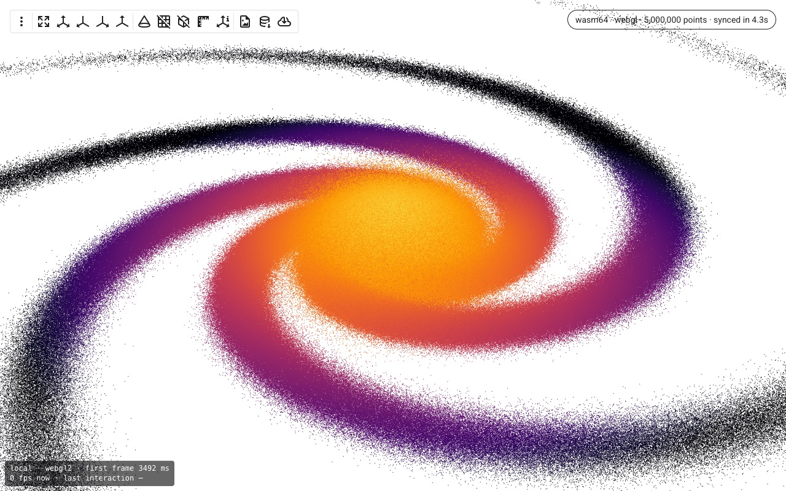 | 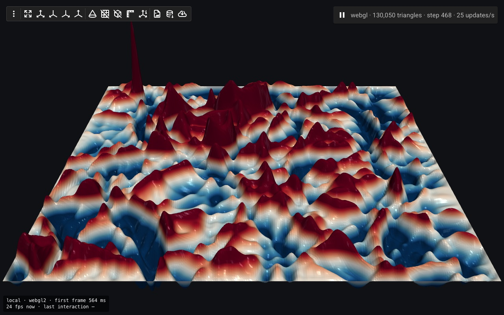 |
| `trame.glyph`: 43k object voxel island, GPU instancing | `trame.pbr`: PBR materials and image based lighting |
| 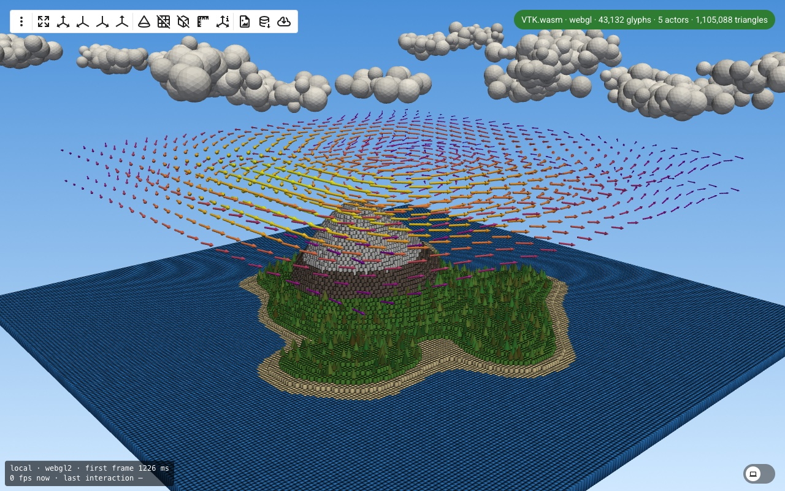 | 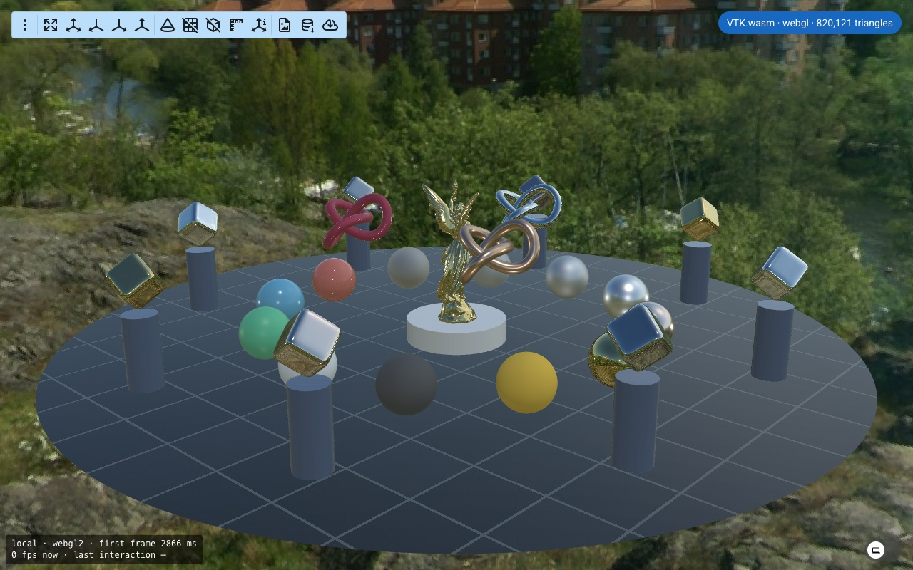 |
| `trame.pbr-legacy`: the same scene with vtk.js | `trame.transparency`: depth peeling stress test |
| 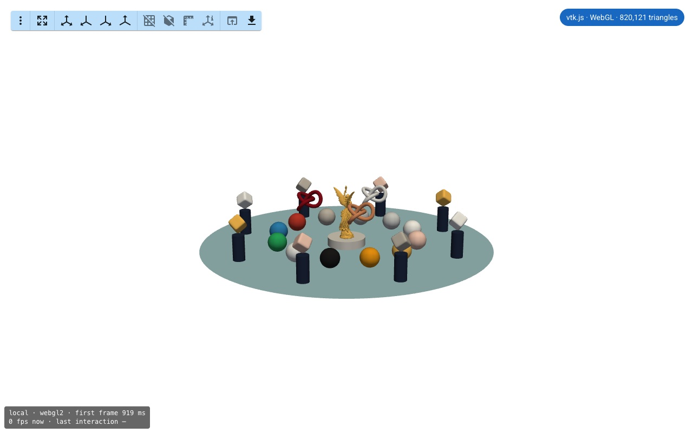 | 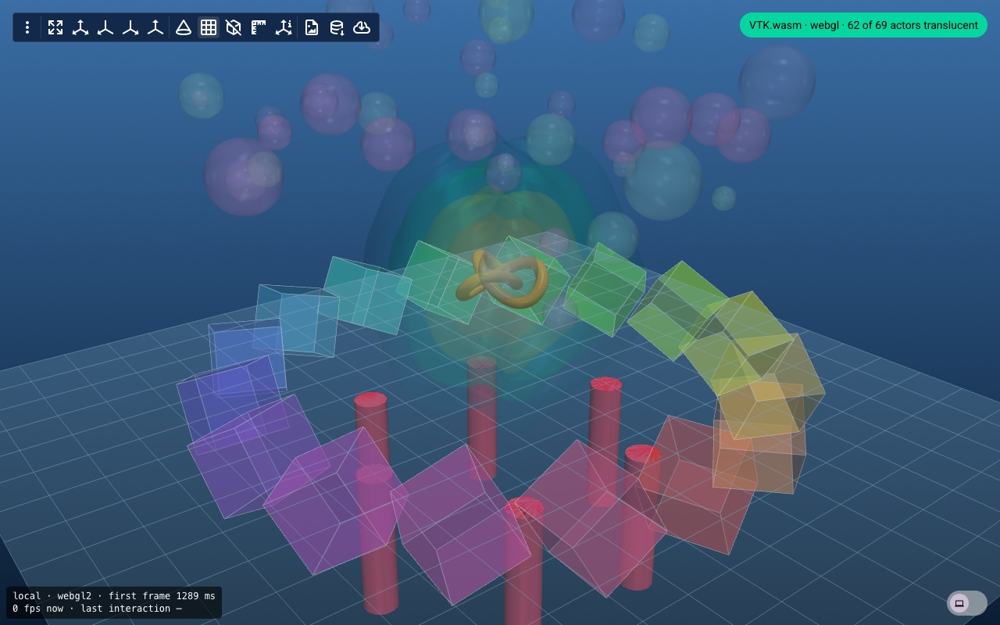 |
| `trame.asteroid-impact`: WebGL weighted blend vs. WebGPU deep framebuffer | `trame.bearing-assembly`: the same comparison, as a WebGL / WebGPU toggle |
| 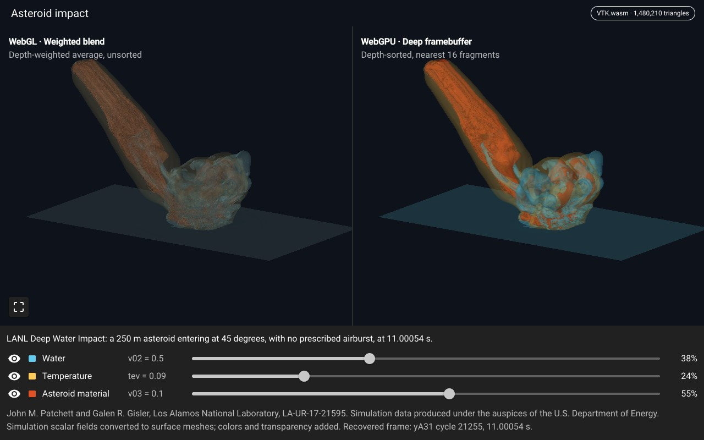 | 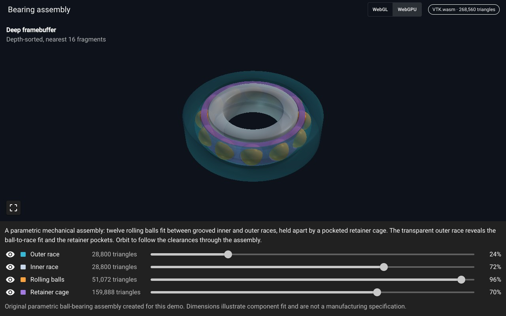 |
| `trame.volume-rendering`: chest CT ray cast with 3D Slicer presets | `export.bunny-html`: self-contained HTML page, no server |
| 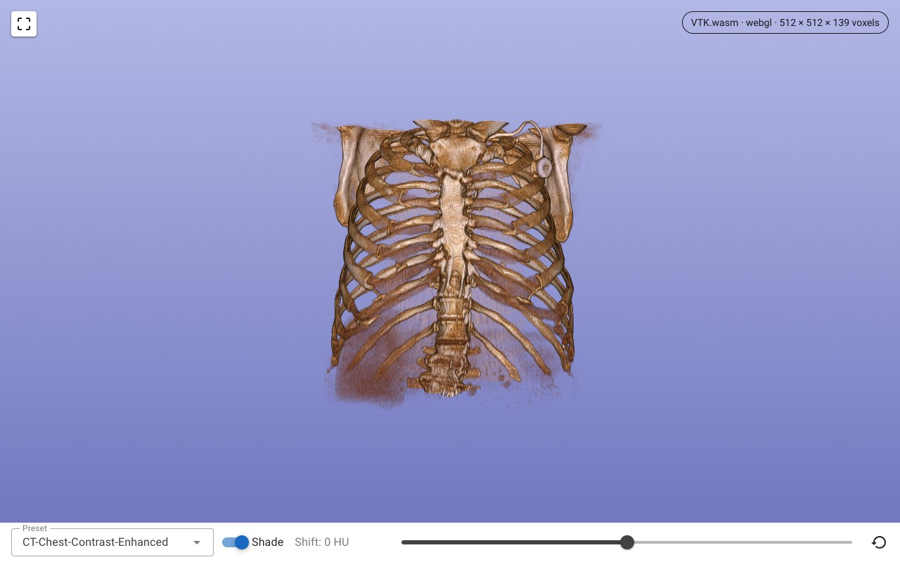 | 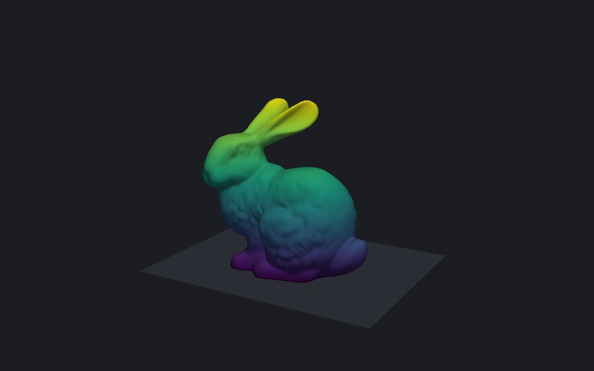 |

### Notes

- `--webgpu` also asks the server to render with WebGPU, which needs a VTK
  built with `VTK_ENABLE_WEBGPU=ON`; otherwise the server falls back to OpenGL,
  as shown in the chip when rendering remotely.
- VTK's WebGPU backend has no PBR shaders yet: `pbr --webgpu` is Phong shaded.
- The uv setup (`uv sync`, nox, CI) pins the tested VTK nightly
  (`[tool.uv]` in `pyproject.toml`), see [Install](#install) to get it with pip.

## Contributing

See [CONTRIBUTING.md](CONTRIBUTING.md) for the development setup, how to add a
demo and how releases are made.

## License

[Apache License 2.0](LICENSE)
